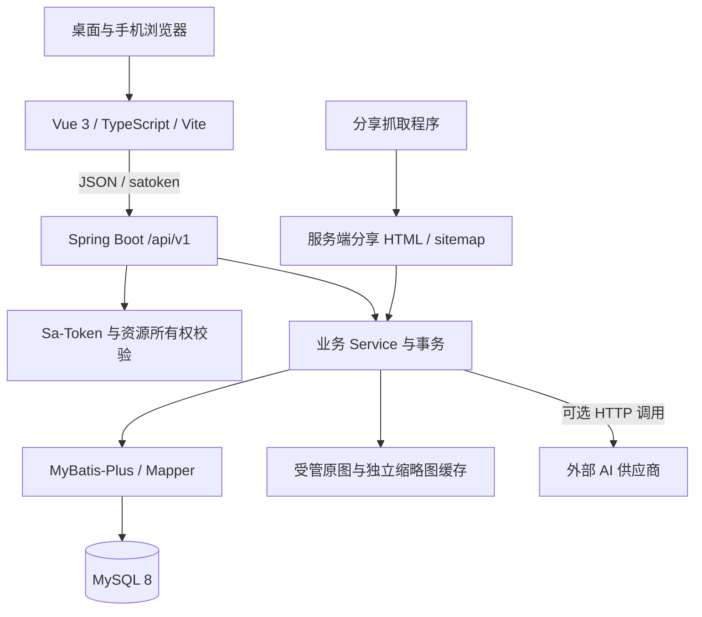

# 系统架构

系统采用前后端分离的模块化单体。浏览器负责内容展示和编辑，业务校验、鉴权、事务及 AI 外呼集中在 Spring Boot，MySQL 保存结构化数据。

## 通信关系

## 前端

`views` 组织路由页面，`components` 保存复用界面，`api` 集中请求，`types` 定义传输类型，`stores` 管理登录态与主题。组合函数处理筛选、游标加载及局部交互。Vditor 是当前攻略编辑器，正文继续使用 Markdown。

Axios 请求携带当前令牌。迟到请求只影响其所属账号和页面版本。页面处理加载、空结果、失败及重试，路由守卫引导登录，后端再次校验权限。

## 后端模块

| 包 | 职责 |
|---|---|
| `user`、`security` | 身份、资料、会话和权限 |
| `guide`、`destination` | 攻略、标签、目的地和关联资料 |
| `interaction`、`comment`、`notification` | 点赞收藏、评论线程、提及与通知 |
| `itinerary`、`ai` | 私人计划、导入、模型预览与结果校验 |
| `file` | 上传、受管读取、缩略图 |
| `search`、`sharing` | 五类公开对象查询、服务端分享元数据 |
| `administration` | 账号与公开内容治理 |
| `common` | 响应、错误、校验、时间和基础工具 |

Controller 处理入口参数和响应，Service 维护业务规则及事务，Mapper 绑定参数并执行查询。评论、提及及通知共用一次数据库事务。外部模型等待位于业务事务之外，返回后重新校验地点状态。

## 持久化和权限

当前空库结构为 18 张表，图片只保存受管路径。原图和缩略图使用独立目录，业务备份同时包含数据库、原图和服务端私有配置。账号角色为 USER/ADMIN，资源所有者从认证上下文和数据库关系确认。

业务时间统一为 Asia/Shanghai。JDBC 使用固定 `+08:00` 会话偏移，JSON 时间带明确偏移。旅行日期和活动时间分别保持 DATE、TIME 语义。搜索快照也显式采用同一业务时区。

## 运行方式

开发环境由 Vite 代理 `/api`、`/uploads` 和分享相关入口。部署时可由 Nginx 承载静态 Web 并转发后端路径。登录态保存在单体内存中，后端重启后需要重新登录。配置、迁移和备份步骤见 [运维说明](22-deployment-and-operations.md)。
