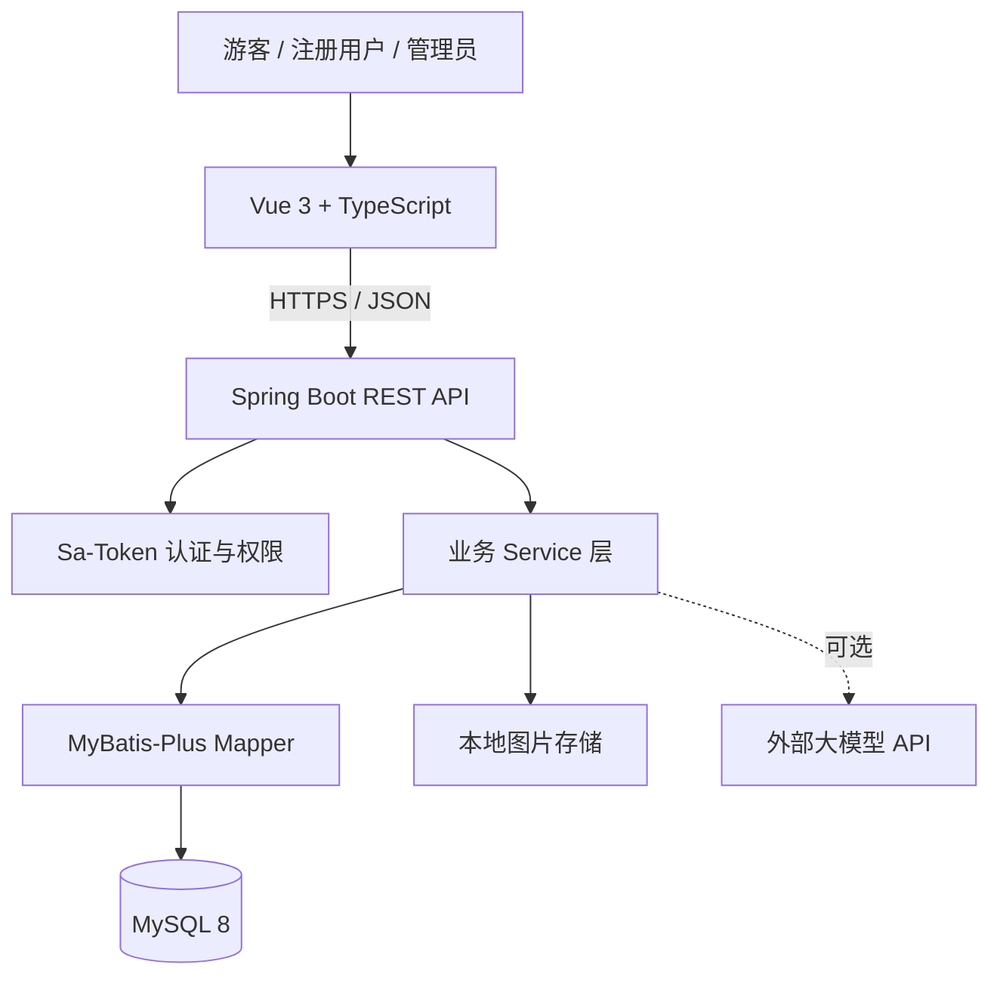

# 系统架构设计

## 1. 架构决策
采用前后端分离的模块化单体：
- Vue 3 SPA 负责展示和交互；
- Spring Boot 提供 REST API；
- MySQL 保存业务数据；
- 本地文件系统保存图片；
- AI 作为可选外部 API。

不采用微服务，降低毕业设计开发、部署和调试成本。

## 2. 逻辑架构



## 3. 前端模块
`views/` 页面；`components/` 公共组件；`layouts/` 布局；`api/` 请求；`stores/` Pinia；`router/` 路由；`types/` 类型；`utils/` 工具。

## 4. 后端模块
建议按业务域组织：
```text
com.example.travelplatform
├── common
├── config
├── security
├── user
├── destination
├── guide
├── interaction
├── itinerary
├── file
├── admin
├── ai
└── exception
```
各业务域内部按 controller/service/mapper/entity/dto/vo 分层。也可采用统一分层包，但必须职责清晰。

## 5. 部署
开发：Vite dev server、Spring Boot、本地或容器 MySQL，Vite proxy 转发 `/api`。
演示/生产：Nginx 提供静态资源并反代 API；上传目录使用持久化磁盘；MySQL 独立运行并备份。
第一版不要求 Docker/Kubernetes。

## 6. 认证与授权
Sa-Token 管理登录态；密码 BCrypt；角色 USER/ADMIN；写接口后端校验身份；资源修改校验所有者；管理员接口校验 ADMIN。前端路由守卫不承担安全边界。

## 7. 图片存储
头像、目的地封面、攻略封面和正文图片第一版本地存储。数据库保存相对访问路径。后端统一管理映射和上传限制，不允许用户控制磁盘绝对路径。

## 8. AI 边界
封装 `AiItineraryService`，密钥从环境变量读取；超时、异常处理；校验模型 JSON 结构；用户确认后保存为 itinerary 数据。AI 失败不影响其他模块。

## 9. 时区
业务时间统一按 `Asia/Shanghai` 处理。数据库连接、Java 时区和 JSON 序列化一致。日期使用 DATE，活动时间使用 TIME，创建/更新时间使用 DATETIME(3)，避免旅行日期被错误转换为 UTC 日期。
