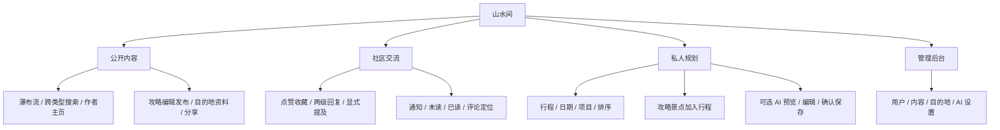

# 功能模块与页面

## 功能结构

## 公开页面

| 路由 | 内容 |
|---|---|
| `/`、`/guides` | 发现流与攻略列表 |
| `/guides/:id` | 公开攻略、互动、评论抽屉及加入行程 |
| `/search` | 攻略、城市、景点、作者和话题搜索 |
| `/users/:username` | 作者公开资料、作品及手记中的目的地 |
| `/destinations`、`/destinations/:id` | 目的地列表和详情 |
| `/login`、`/register` | 登录与注册 |

## 登录用户页面

| 路由 | 内容 |
|---|---|
| `/guides/new`、`/guides/:id/edit` | 新建和编辑本人攻略 |
| `/me` | 恢复登录态后进入本人公开主页 |
| `/me/settings` | 修改个人资料 |
| `/me/guides`、`/me/favorites` | 本人作品与收藏 |
| `/me/notifications` | 通知、未读筛选及已读操作 |
| `/me/itineraries` | 私人行程列表和新建入口 |
| `/itineraries/:id` | 行程根信息、日期及项目编辑 |
| `/itineraries/ai` | AI 工作台与手动规划入口 |

`/guides/:id?comments=1&commentId=...` 用于打开并定位通知对应的评论。行程新建、日期和项目编辑由页面内表单或抽屉完成。

## 管理页面

`/admin` 为概览，子页包括 `/admin/users`、`/admin/guides`、`/admin/comments`、`/admin/destinations`、`/admin/ai`。入口需要登录与管理员角色，后端对各项操作重新授权。

服务端的 `/share/guides/:id` 和 `/share/users/:username` 返回静态分享 HTML。它们与 Vue 路由分别处理，部署时需要将分享路径转发到后端。

## 界面组织

用户端共用 SiteHeader、内容卡片、评论抽屉、加入行程抽屉及图片灯箱。窄屏重新安排导航和互动栏。请求状态包含首次加载、追加加载、空结果、错误、无权限和目标失效，输入与错误提示通过明确标签和可访问焦点表达。
