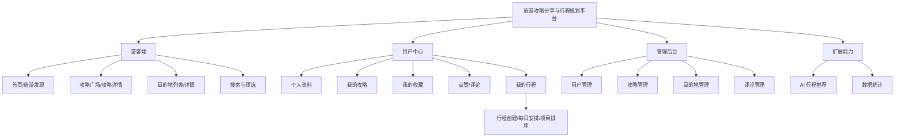

# 系统功能结构与页面规划

## 1. 功能结构图

## 2. 页面路由

### 游客端
| 路由 | 页面 | 权限 |
|---|---|---|
| `/` | 首页 | 公开 |
| `/guides` | 攻略广场 | 公开 |
| `/guides/:id` | 攻略详情 | 公开 |
| `/destinations` | 目的地列表 | 公开 |
| `/destinations/:id` | 目的地详情 | 公开 |
| `/search` | 搜索结果 | 公开 |
| `/login` | 登录 | 未登录 |
| `/register` | 注册 | 未登录 |

### 用户中心
| 路由 | 页面 |
|---|---|
| `/publish` | 发布攻略 |
| `/guides/:id/edit` | 编辑攻略 |
| `/me` | 个人资料 |
| `/me/guides` | 我的攻略 |
| `/me/favorites` | 我的收藏 |
| `/itineraries` | 我的行程 |
| `/itineraries/new` | 创建行程 |
| `/itineraries/:id` | 行程详情 |
| `/itineraries/:id/edit` | 编辑行程 |
| `/ai-planner` | AI 行程助手（选做） |

### 管理后台
| 路由 | 页面 |
|---|---|
| `/admin` | 管理概览 |
| `/admin/users` | 用户管理 |
| `/admin/guides` | 攻略管理 |
| `/admin/destinations` | 目的地管理 |
| `/admin/comments` | 评论管理 |

## 3. 页面布局
游客端统一顶部导航和页脚；个人中心使用侧栏或二级导航；管理后台独立布局。攻略列表以图片卡片为主；攻略详情突出标题、封面、作者和正文；目的地详情突出大图、简介和关联攻略；行程详情按日期分组展示。

## 4. 页面状态
每个异步页面考虑首次加载、加载中、有数据、空数据、请求失败、无权限和数据不存在。

## 5. 公共组件
`AppHeader`、`AppFooter`、`GuideCard`、`DestinationCard`、`SearchBar`、`FilterPanel`、`LikeButton`、`FavoriteButton`、`CommentList`、`MarkdownViewer`、`MarkdownEditor`、`ImageUploader`、`Pagination`、`ItineraryTimeline`、`ItineraryDayEditor`、`EmptyState`、`ErrorState`、`LoadingState`。
