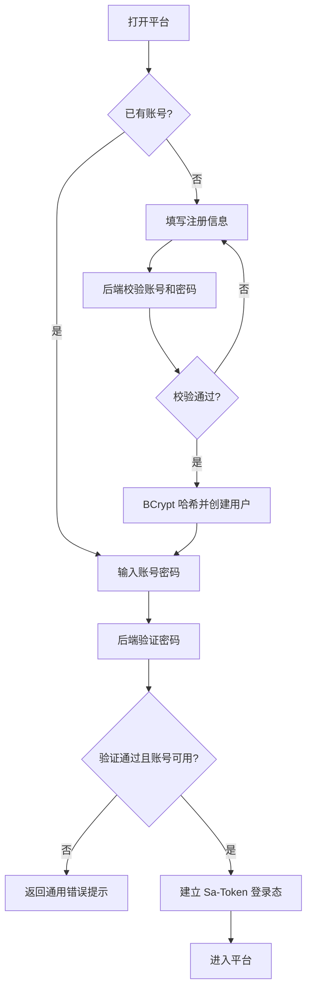
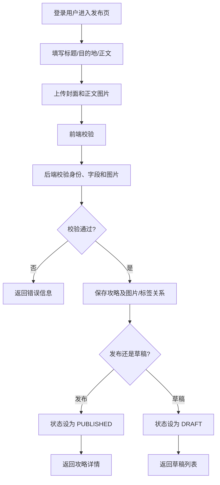
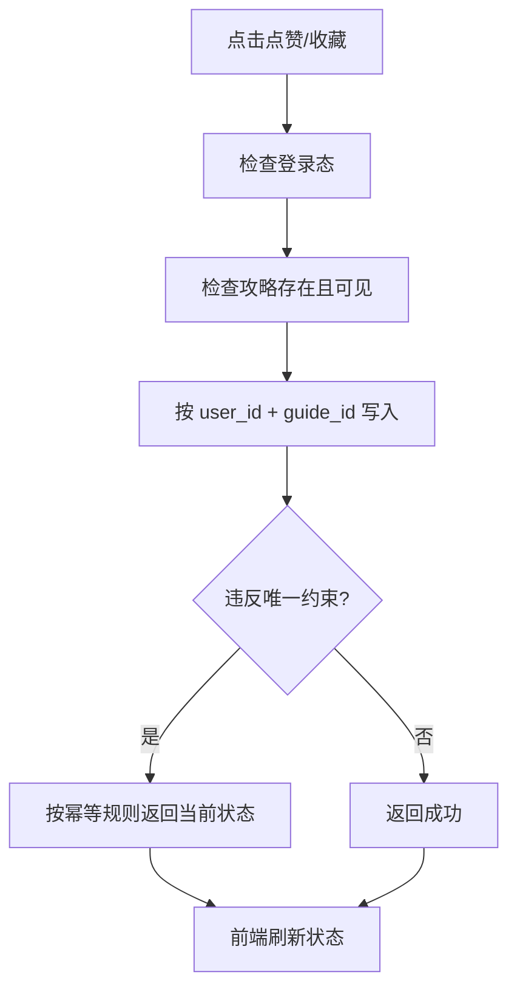
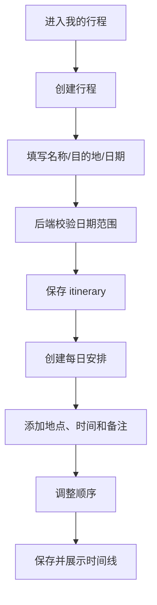
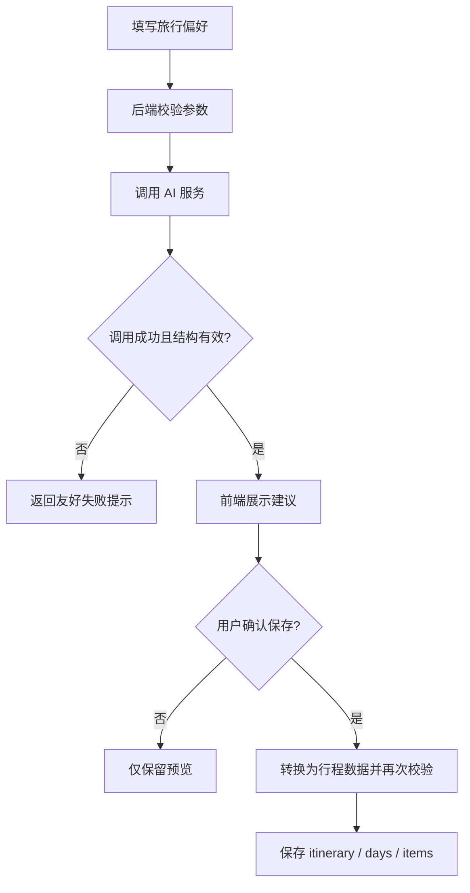

# 核心业务流程

## 1. 注册与登录

## 2. 发布攻略

## 3. 点赞和收藏

建议 PUT 添加、DELETE 取消，数据库联合唯一索引防重。

## 4. 创建手动行程

每次修改都检查行程所有者。每日安排日期必须落在行程范围内。

## 5. AI 推荐保存（选做）

AI 输出只能作为建议，不能信任模型生成的用户 ID、目的地 ID 或内部字段。

## 6. 状态与历史数据补充（2026-11-02）

- 草稿通过作者私有读取入口进入编辑，公开详情不读取草稿或隐藏攻略。
- 管理员仅将已发布攻略隐藏/恢复；作者不能编辑或重新发布隐藏内容，仍可删除自己的攻略。编辑、撤回、再次发布和隐藏/恢复均保留首次发布时间。
- 目的地停用保留历史关联；新建或替换关联拒绝停用目的地。
- 禁用用户立即失去受保护业务访问权限，不能只阻止下一次登录。
- 缩短行程日期若排除已有日程则拒绝，不自动删除；排序先确认所有项目均属于该用户的同一天，再在事务中保存。

准确接口与响应规则见 `docs/06-api-contract.md` 第 11–15 节。
