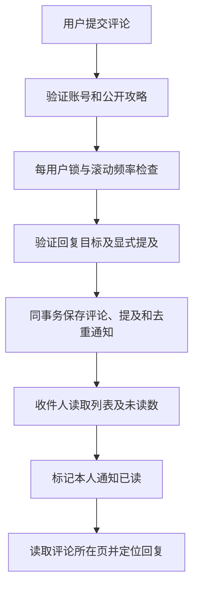
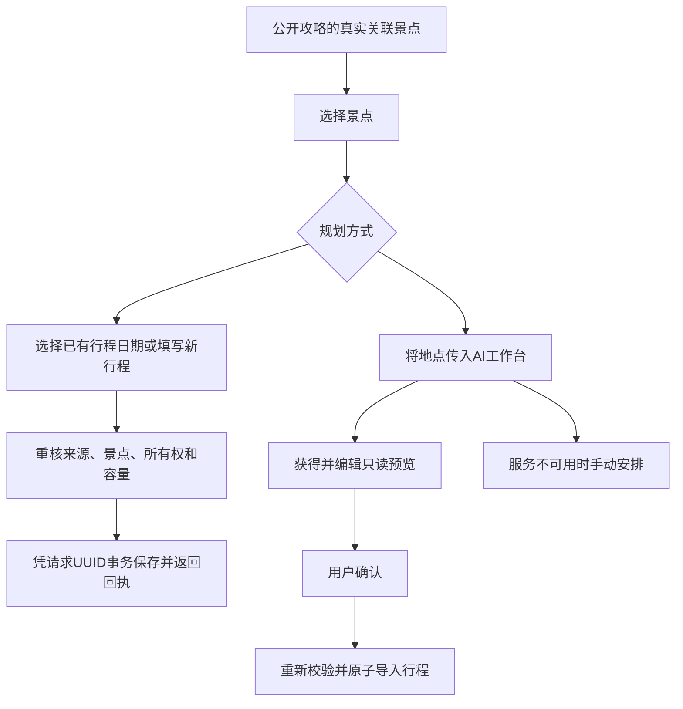

# 主要业务流程

## 身份与内容发布

注册接口验证用户名、密码及重复账号，保存 BCrypt 哈希。用户登录后获得独立令牌，通过请求头访问受保护入口，退出只使当前令牌失效。

攻略写入校验当前作者、受管图片、目的地、景点和标签关系，在同一事务中保存主体及关联。草稿由作者私有入口读取，发布后进入公开列表。首次发布时间在后续编辑、撤回和治理中保留。管理员通过状态接口隐藏与恢复内容。

## 点赞、收藏与社区消息

点赞和收藏使用 PUT 添加、DELETE 取消，联合唯一键保证重复请求的幂等性。评论回复统一归入一个根线程，保留直接回复对象。提及通过公开账号建议选择并验证正文标记。隐藏或删除的目标退出通知查询结果。

## 从攻略整理私人行程

重复的同内容 UUID 返回历史回执，变更提交内容需要新 UUID。追加时按地点识别已有项目，返回新增与跳过结果。日期缩短若排除已有日程则拒绝，项目排序要求同一天全部项目的完整排列。

## AI 预览

服务端根据城市、日期、预算和偏好收集受限的公开地点资料与攻略摘录，调用外部 API 后校验 JSON、日期和真实地点标识。生成预览不创建行程。单日重生成只替换目标日，页面忽略旧账号、旧需求或旧编辑版本的迟到结果。

确认保存时重新验证数据关系，整程、每日及项目共用一次事务。超时、供应商失败或输出不合规时保留手动入口，AI 密钥始终由服务端管理。

## 历史数据

停用目的地保留原有关联，新建或替换关系须使用有效地点。逻辑删除主体时保留关系记录，公开查询和私人资源访问分别核对父资源状态及归属。数据库升级采用增量文件，步骤见 [数据库说明](../database/README.md)。
