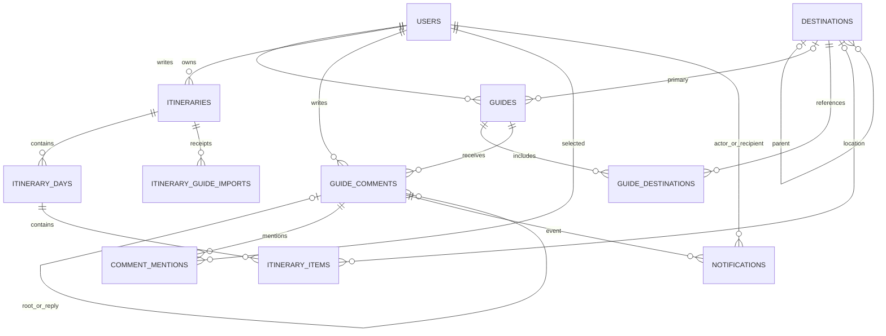

# 数据库设计

采用 MySQL 8.x、InnoDB 和 utf8mb4。当前空库结构由 [schema.sql](../database/schema.sql) 定义，包含 18 张表、151 列和 31 个外键。既有库通过 [增量迁移](../database/README.md) 升级。

## 表与职责

| 表 | 职责与重要关系 |
|---|---|
| `users` | 账号、BCrypt 哈希、公开资料、USER/ADMIN 角色及状态 |
| `destinations` | 城市、景点和其他地点，可空父城市及资料来源 |
| `destination_images` | 目的地有序图库、作者与素材许可 |
| `guides` | 作者、主目的地、Markdown、状态及首次发布时间 |
| `guide_images` | 攻略有序图片 |
| `guide_destinations` | 攻略与真实关联景点，多对多且组合唯一 |
| `tags`、`guide_tags` | 标签字典及攻略标签关系 |
| `guide_likes`、`guide_favorites` | 用户和攻略组合唯一的互动关系 |
| `guide_comments` | 根评论、二级回复和直接回复目标 |
| `comment_mentions` | 评论与显式提及账号组合唯一 |
| `notifications` | 发起者、收件人、攻略和评论，收件人/评论组合唯一 |
| `comment_write_locks` | 每用户一条评论写入串行化锁记录 |
| `itineraries` | 私人行程、所有者、日期和可空整程导入请求 UUID |
| `itinerary_days` | 行程内唯一日期和日序号 |
| `itinerary_items` | 日程项目、可空地点关系及名称快照、顺序 |
| `itinerary_guide_imports` | 攻略景点导入回执、内容摘要和幂等结果 |

## 核心关系

完整外键与 CHECK 以 SQL 为准。图中合并展示评论的根/直接目标关系及通知的两条用户关系，标签、图片和互动关系在表清单列明。`itinerary_guide_imports.day_id` 是已保存目标标识，当前没有日程外键。

## 字段与状态

ID 使用 signed BIGINT，与 Java Long 一致，JSON 中传递字符串。创建更新时间为 DATETIME(3)，行程日期和时间保持 DATE、TIME。金额使用 DECIMAL，图片字段保存访问路径。

账号状态为 ACTIVE/DISABLED，目的地为 ACTIVE/INACTIVE，攻略为 DRAFT/PUBLISHED/HIDDEN，评论为 NORMAL/HIDDEN。存在 `is_deleted` 的主体采用逻辑删除，查询必须检查主体和必要父资源的状态。物理外键级联不会代替逻辑删除的可见性校验。

停用目的地保留历史关系，新建或替换关联须指向有效地点。首次 `published_at` 在编辑、撤回与治理中保留。`ip_region` 历史列继续保存，当前公开响应由统一开关返回 null。

## 事务与并发

- 攻略主体、图片、标签和景点替换在同一事务完成。
- 点赞、收藏、提及及通知由联合唯一键去重。
- 历史评论的 `root_id`、`reply_to_id` 均为空。回复统一指向一个根线程，直接目标保留对话对象。
- 评论创建依次共享锁定当前用户、串行化每用户评论锁、锁定攻略后检查滚动次数。正文、提及、通知原子提交。
- 行程日期和子项目通过完整父子关系核验归属。缩短日期排除已有安排时拒绝，项目排序验证同日完整排列。
- 整程导入按当前用户和请求 UUID 复用已有行程。攻略导入额外校验内容摘要，提交失败回滚，同内容重试返回已有回执。

评论频率从真实评论记录查询，专用锁表只协调并发。互动数量按关系计算，当前结构没有浏览量冗余计数。

## 索引与检索

索引围绕用户唯一账号、公开攻略排序、关系联合唯一、线程回复顺序、通知收件人/已读时间、行程所有者与日期设计。普通搜索使用参数化 LIKE 并转义通配符，跨类型查询由数据库聚合返回。当前没有全文搜索服务。

## 初始化和升级

`schema.sql`、`seed.sql` 作用于调用方明确选择的空库，示例数据只包含公开目的地和标签。既有数据库使用 V008、V010、V016、V017 中与当前版本差异对应的迁移，具体顺序见数据库说明。`CREATE TABLE IF NOT EXISTS` 不补齐既有表的新列。

M17 已在独立恢复副本及测试库重复执行迁移，并与新空库逐项核对列、索引、外键动作和 CHECK，结果一致。原业务库仍为 14 表，当前新结构的验证不表示原业务库已升级。[实际测试报告](../output/m17/项目P1完成情况与真实测试报告.md)
