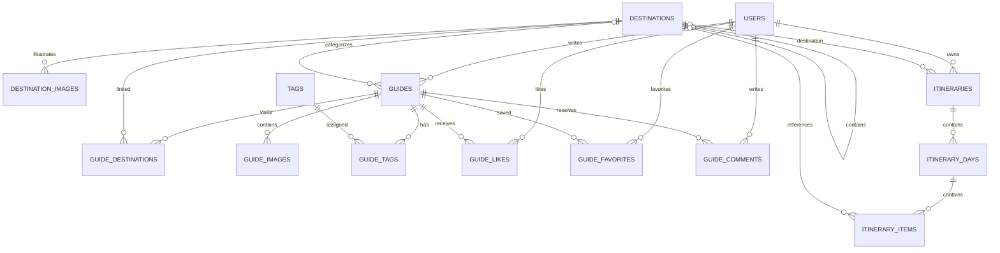

# 数据库详细设计

数据库：MySQL 8.x；InnoDB；utf8mb4。SQL 初稿见 `database/schema.sql`。

## 1. 设计原则
signed BIGINT 自增主键及同类型外键，与 Java Long 范围一致；REST 中 ID 使用字符串以避免 JavaScript 精度丢失。snake_case；DATETIME(3)；金额 DECIMAL；密码只保存 BCrypt 哈希；关系表联合唯一索引；图片只存访问路径；逻辑删除和状态语义明确。

## 2. 表清单
| 表 | 职责 |
|---|---|
| `users` | 用户账号、资料和角色 |
| `destinations` | 城市/景点目的地 |
| `destination_images` | 目的地有序图片、来源与授权 |
| `guides` | 攻略主体 |
| `guide_images` | 攻略图片 |
| `guide_destinations` | 攻略与多个同城景点关系 |
| `tags` | 攻略标签 |
| `guide_tags` | 攻略标签关系 |
| `guide_likes` | 点赞关系 |
| `guide_favorites` | 收藏关系 |
| `guide_comments` | 评论 |
| `itineraries` | 用户行程 |
| `itinerary_days` | 每日安排 |
| `itinerary_items` | 每日游玩项目 |

## 3. ER 关系

## 4. 关键约束
- `users.username` 唯一；role 为 USER/ADMIN；status 为 ACTIVE/DISABLED。
- `destinations.destination_type` 为 CITY/SCENIC_SPOT/OTHER；parent_id 可空；status 为 ACTIVE/INACTIVE。
- `guides.author_id` 关联用户；destination_id 可空；正文 Markdown；status 为 DRAFT/PUBLISHED/HIDDEN；预算 DECIMAL(10,2)；逻辑删除。
- `guide_likes`、`guide_favorites` 对 `(user_id, guide_id)` 联合唯一。
- `guide_comments` 第一版不做评论树；status 为 NORMAL/HIDDEN。
- `itineraries` 归属 user；start_date 不晚于 end_date。
- `itinerary_days` 对 `(itinerary_id, day_no)` 和 `(itinerary_id, travel_date)` 唯一。
- `itinerary_items` 可关联 destination，也保存 place_name 快照；sort_order 控制顺序。
- 每日日期必须落在行程日期范围内，由 Service 校验。
- `day_no` 由 travel_date 相对行程 start_date 的日期差加一计算；缩短行程排除已有日程时拒绝修改，不自动删除子数据。
- 第一版不维护浏览量计数；热度按点赞关系聚合，避免无验收依据的冗余计数器。

### 逻辑删除和状态边界

有 `is_deleted` 的业务主体使用逻辑删除。删除主体不会触发数据库 ON DELETE，Service 查询和关联查询必须显式检查主体未删除；不能假定物理外键级联会处理逻辑删除。

点赞/收藏取消、攻略图片/标签关系替换、每日安排或项目的显式删除可物理删除关联/子数据。逻辑删除攻略或行程时保留其关联数据，但公开列表、收藏和子资源接口必须检查父资源可见性/所有权。用户名的唯一占用在逻辑删除后保留，不开放复用。

攻略 DRAFT/PUBLISHED/HIDDEN 的转换及停用目的地历史关联规则见 `docs/06-api-contract.md` 第 13–14 节。管理员只治理状态；隐藏/恢复保留原 published_at。所有级联修改与排序在事务中完成，且重排必须验证同一天项目的完整无重复 ID 集合。

## 5. 索引建议
users：username 唯一；destinations：status/type/parent_id、name；guides：status/is_deleted/published_at、destination_id/status/is_deleted、author_id/created_at；guide_tags：guide_id/tag_id 唯一和 tag_id 索引；likes/favorites：user_id/guide_id 唯一；comments：guide_id/status/created_at；itineraries：user_id/status/created_at；days：行程+日期/序号唯一；items：day_id/sort_order。

## 6. 搜索
第一版使用 MySQL LIKE 或必要的全文索引实现关键词搜索，配合目的地和标签筛选。不要为普通毕业设计引入 Elasticsearch。限制 page size，转义 LIKE 特殊字符。

## 7. 初始化数据
`database/seed.sql` 只放公开目的地和标签示例，不创建明文默认管理员。管理员应通过安全首次启动流程或人工命令创建。

SQL 脚本不创建或切换数据库，调用者必须显式选择目标库；测试只在经确认的独立空库执行。已验证本机原服务为 26.7.0，用户随后授权单独准备 MySQL 8.4 并保留原服务，见 ADR-018；凭据保留在本地，具体运行验证见基线审查记录。`CREATE TABLE IF NOT EXISTS` 不代替后续结构迁移。

## 8. M8 增量字段与关系

destinations 新增 address、DECIMAL(9,6) longitude/DECIMAL(8,6) latitude、recommended_duration_minutes、recommended_days、opening_hours、ticket_info、official_url、source_url、verified_at，全部可空。坐标成对且有范围 CHECK；分钟 1–1440、天数 1–30。CITY 无父；SCENIC_SPOT 直属 CITY，服务层维护层级及历史停用边界。

destination_images 保留图片路径、说明、顺序、来源/作者/许可/许可链接/获取时间，唯一(destination_id,image_url)，顺序索引(destination_id,sort_order,id)。guide_destinations 唯一(guide_id,destination_id)，反向索引(destination_id,guide_id)。三条新外键均 RESTRICT；逻辑删除主体不物理级联。图库和攻略景点替换分别与主体同事务。

itineraries 增加可空 client_request_id CHAR(36)，唯一(user_id,client_request_id)，供整程原子导入防重；原手动创建保持 NULL。没有新增 AI 行程表。DDL 与新空库 SQL 已在 MySQL 8.4.13 验证等价，精确 SQL 及哈希见 database/migrations/manifest.json。
